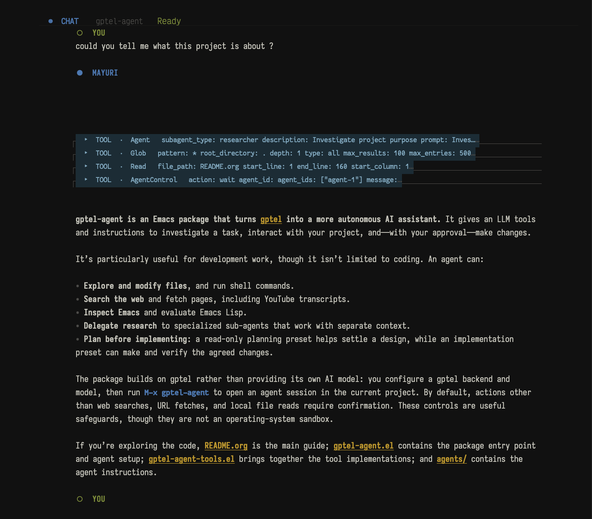

# gptel-ui



`gptel-ui` provides the optional **Atelier** reading view for ordinary gptel
conversations in Org and Markdown. It owns chat presentation, including
conversations opened by `gptel-runner` and discussion tools. Jobs, pipelines,
their dashboards, and conversation persistence stay in `gptel-runner`.

The package requires Emacs 29.1 or newer. It can be loaded and tested without
`gptel-runner`; install gptel to use it with live conversations.

## Installation

Put this repository on `load-path` and enable the view:

```elisp
(add-to-list 'load-path "/path/to/gptel-ui")
(require 'gptel-ui)
(gptel-ui-global-mode 1)
```

The global mode follows existing and future gptel conversations. Use
`M-x gptel-ui-mode` to enable it in a single buffer, or
`M-x gptel-ui-demo` to preview the appearance without a model request.

## Reading and navigation

Atelier adds speaker labels, a comfortable reading width, section headings,
code panels, clickable file references, and expandable discussion report
metadata. Pipe tables use aligned fixed-pitch columns and become labeled
rows when the pane is too narrow. Styling follows the current theme's text
and accent faces, with separate light and dark code panels.

Each assistant turn has one speaker label across its tool calls and final
answer. Tool results use compact activity headers with expandable INPUT and
OUTPUT details; quotations use an italic text rail. Click a tool header or
press `RET` to use gptel's native folding. Pending approval controls retain
their existing shortcuts.

The header puts a clickable pending-approval count before the chat identity
and live status. It includes approvals in other chats and hidden subagent
buffers, so a busy main conversation cannot scroll the notice away. Click
the count or use `C-c ]` / `C-c [` to cycle through approval prompts; at the
prompt, `C-c C-c` accepts and `C-c C-k` refuses using gptel's native controls.
Cycling wraps around and remains available after jumping into a subagent.
The compact header hides the native Prompt/model controls by default; set
`gptel-ui-header-details` to `t` to include them again.

Copying from the reading view omits hidden assistant prefixes and removes
gptel response properties, so pasting a reply into your draft does not mark
it as another assistant response. Use source view for an exact source copy;
cutting text retains the original content for undoing or moving it.

| Action | Key or command |
| --- | --- |
| Open a file or web link | Click or `RET` on the reference |
| Open or choose a link inside a table | `C-c C-o` |
| Expand report details | Click or `RET` on its header |
| Read or edit the original source | `C-c C-v` |
| Next / previous conversation turn | `C-c C-n` / `C-c C-p` |
| Next / previous pending approval (across buffers) | `C-c ]` / `C-c [` |
| Accept / refuse the approval at point | `C-c C-c` / `C-c C-k` |
| Refresh the display | `M-x gptel-ui-refresh` |
| Preview locally | `M-x gptel-ui-demo` |
| Enable in one buffer | `M-x gptel-ui-mode` |

File references support project-relative and absolute paths, Markdown and
Org links, and line/column suffixes. Relative references resolve from the
chat's working directory. Existing backtick-quoted filenames also become
links. Use the source view to edit rendered tables and inspect their markup.

The reading view uses overlays and buffer-local settings. It does not
rewrite conversations or alter their message roles, request behavior,
saved sessions, or undo history. Disable the mode to restore the previous
buffer presentation and copying behavior.

## Customization

| Option | Default | Purpose |
| --- | --- | --- |
| `gptel-ui-width` | `100` | Preferred reading width in columns, including padding |
| `gptel-ui-table-width` | `nil` | Table width limit; `nil` fits the conversation window |
| `gptel-ui-refresh-delay` | `0.18` | Seconds between display updates while streaming |
| `gptel-ui-assistant-name` | `"Assistant"` | Label when no named response prefix is available |
| `gptel-ui-header-details` | `nil` | Include native header settings such as Prompt and model |

Use the `gptel-ui`, `gptel-ui-tables`, and `gptel-ui-tools` customization
groups to adjust the appearance and faces.

## Moving from gptel-runner

Chat presentation previously lived in `gptel-runner-chat*.el`. Its
implementation and tests now live here, with `gptel-ui*` names. Add this
repository to `load-path` alongside runner when using both:

```elisp
(add-to-list 'load-path "/path/to/gptel-runner")
(add-to-list 'load-path "/path/to/gptel-ui")
(require 'gptel-runner)
(require 'gptel-ui)
(gptel-ui-global-mode 1)
```

Compatibility loaders in this repository still accept
`(require 'gptel-runner-chat)` and the old links, tables, and tools module
names. Existing public `gptel-runner-chat-*` commands, options, faces,
keymaps, and mode hooks remain supported. The compatibility loaders also
require this repository on `load-path`; runner alone no longer supplies the
presentation modules. Prefer `gptel-ui*` names for new configuration.
After updating the configuration in an existing installation, restart Emacs
to clear the old renderer's buffer-local state before loading the new one.

## Development

```sh
make test
make compile
make checkdoc
```

The unit tests use built-in Emacs libraries and make no model or network requests.
They check transcript and role preservation, clean copying, source-view
restoration, cross-buffer approval navigation and alerts, native tool controls
and folding, responsive tables, and link navigation.
Compilation treats warnings as errors. Override `EMACS` to choose an Emacs
executable; `make clean` removes generated bytecode.

To exercise real Org and Markdown gptel buffers, point the integration tests
at your installed gptel and markdown-mode directories:

```sh
make integration-test INTEGRATION_LOAD_PATH="-L /path/to/gptel -L /path/to/markdown-mode"
```

These tests check native status updates, tool folds, approval controls, and
mode lifecycle without sending model requests.
